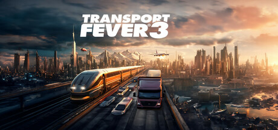

**Transport Fever 3 continues the transportation network simulation series with new map sizes, expanded vehicle types, and deeper passenger and freight demand systems across extended historical timelines from the steam age to the modern era.**

---

## 📖 About

Transport Fever 3 continues the transportation network simulation series with new map sizes, expanded vehicle types, and deeper passenger and freight demand systems across extended historical timelines from the steam age to the modern era.

## ⚠️ Problems Without Trainer

| Problem | Status |
|---------|--------|
| **Demand Modeling** — Understanding freight and passenger demand generation requires system knowledge | ✅ Solved |
| **Multimodal Hubs** — Building efficient transfer points between transport modes requires planning | ✅ Solved |
| **Competition Mode** — Competing against AI transport companies for the same routes is challenging | ✅ Solved |
| **Infrastructure Costs** — Managing tunnels, bridges, and station costs against revenue requires balance | ✅ Solved |

## ✅ Solution

The **Transport Fever 3 Trainer** solves all these issues by giving you complete control over the game.

## 🎯 Full Feature List

- Unlimited Resources
- God Mode / Invincibility
- Instant Skill Cooldown
- One-Hit Kill
- Freeze Game Timer
- Unlock All Items & Achievements
- Custom Speed Multiplier
- Save State Anywhere

## 🚀 Quick Start

1. **Disable Windows Defender** temporarily (trainer may trigger false positive)
2. Download the trainer from the button above
3. Launch Transport Fever 3
4. Run the trainer as Administrator
5. Activate desired cheats with hotkeys

## 💎 Free vs Paid

| Feature | Free | Pro |
|---------|------|-----|
| Basic God Mode | ✅ | ✅ |
| Unlimited Resources | ✅ | ✅ |
| All Advanced Cheats | ❌ | ✅ |
| Auto-Updates | ❌ | ✅ |
| Priority Support | ❌ | ✅ |

## 💻 Requirements

- Windows 10/11 (64-bit)
- Transport Fever 3 (any version)
- .NET Framework 4.8+
- DirectX 11+

## 🍎 macOS

macOS users can use our alternative tool:

## ⚖️ Legal

This trainer is for educational and single-player use only. Use responsibly.

---

